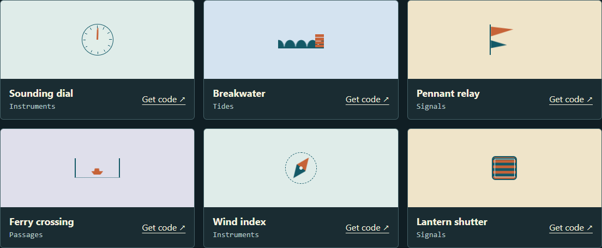

# Driftmark CSS

24 indeterminate CSS loaders drawn from coastal instruments, tides, signal stations, and harbour traffic.

**[Explore the live gallery](https://gowrishetty09.github.io/driftmark-css/)**. Open **Get code** to change the tempo, size, and accessible status text, then copy a complete HTML and CSS snippet.

[](https://gowrishetty09.github.io/driftmark-css/)

| Collection | Try one |
| --- | --- |
| Instruments | [Sounding dial](https://gowrishetty09.github.io/driftmark-css/?loader=sounding-dial) swings a needle across a graduated face. |
| Tides | [Breakwater](https://gowrishetty09.github.io/driftmark-css/?loader=breakwater) rolls a scalloped waterline past a fixed sea wall. |
| Signals | [Pennant relay](https://gowrishetty09.github.io/driftmark-css/?loader=pennant-relay) folds two flags at different points in their cycle. |
| Passages | [Ferry crossing](https://gowrishetty09.github.io/driftmark-css/?loader=ferry-crossing) shuttles a boat between dock posts. |

## Use a loader

Copy a single snippet, or include [loaders.css](loaders.css) once for the full collection.

```html
<link rel="stylesheet" href="./loaders.css">
<span class="dm dm-sounding-dial" role="status">
  <i aria-hidden="true"></i>
  <span class="dm-label">Fetching the forecast</span>
</span>
```

Show the loader while your app is busy and remove it when the operation finishes. Give it status text specific to that operation. If the same message is already visible and announced elsewhere, hide the decorative loader from assistive technology with `aria-hidden="true"`.

Override `--dm-size` to scale the drawing and `--dm-cycle` to change its duration. The colours are `--dm-ink`, `--dm-flare`, and `--dm-sea`. Each drawing has a static reduced-motion state. The gallery also has a manual pause control, shuffle, search, collection filters, and a light/dark switch.

## Run locally

Serve this directory with a static HTTP server, for example `python -m http.server 8000`, then open `http://localhost:8000`. JavaScript powers the gallery controls. The exported loaders animate with CSS alone.

## Design references

Tobias Ahlin’s [SpinKit](https://tobiasahlin.com/spinkit/) explores rotation and staggered timing. Temani Afif’s [dot](https://css-loaders.com/dots/) and [bar](https://css-loaders.com/bars/) collections explore compact repeating forms. Driftmark uses its own drawings, keyframes, names, and nautical palette.

[MIT license](LICENSE) · [Strikeworks button gallery](https://gowrishetty09.github.io/strikeworks-css/)
